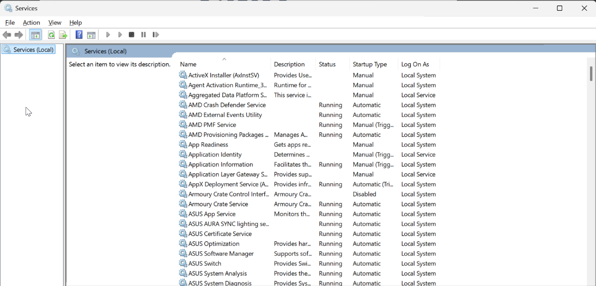
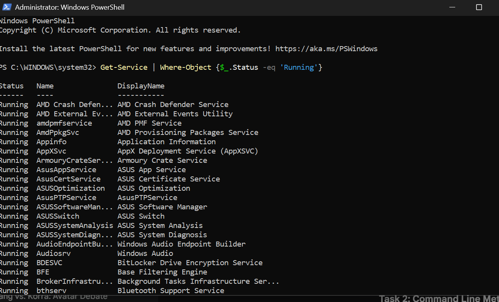
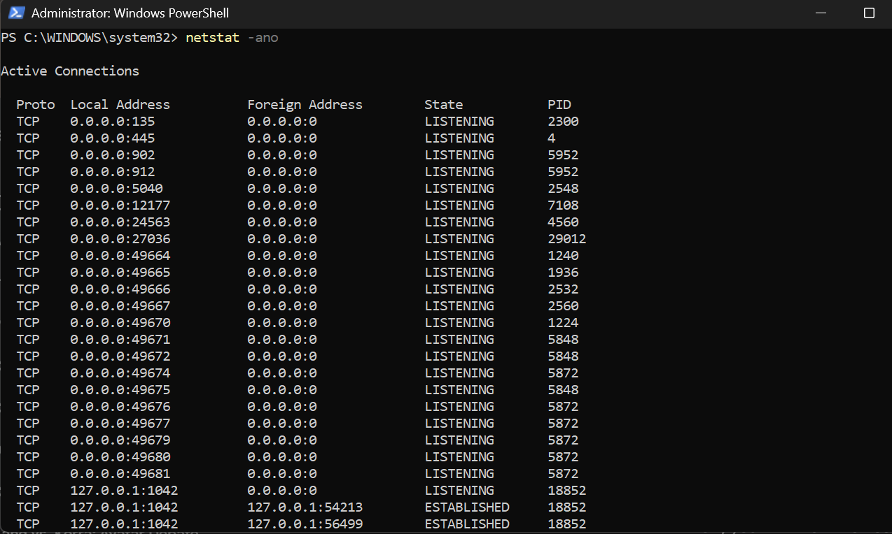
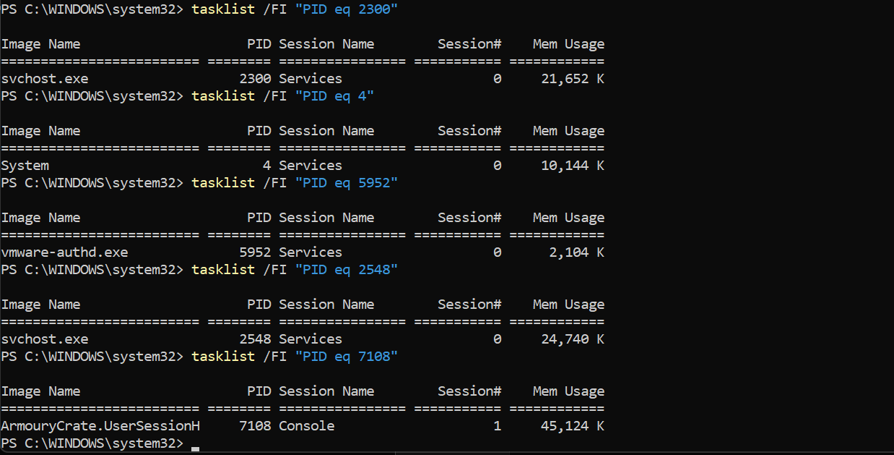
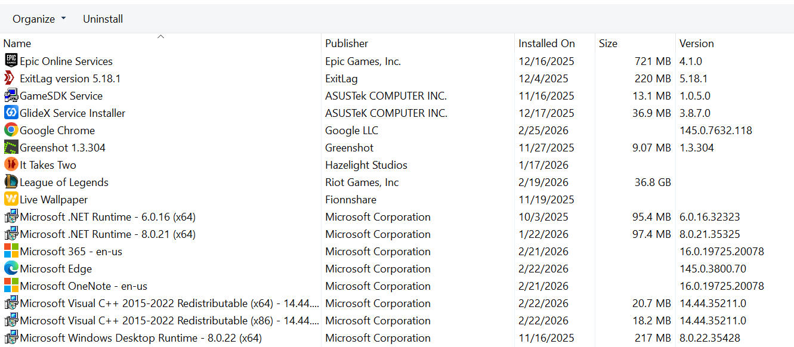
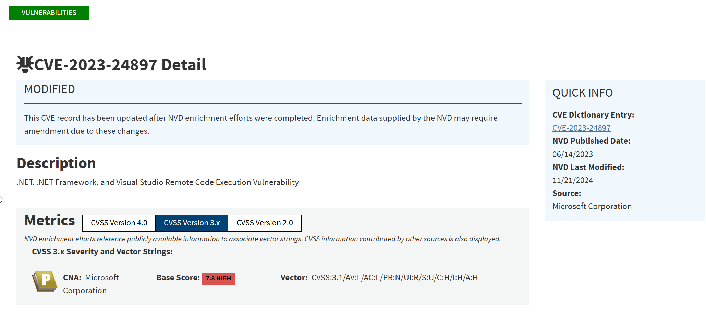
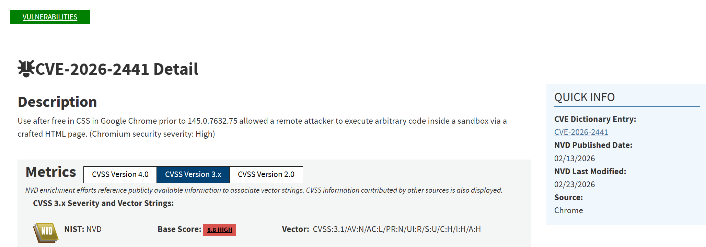
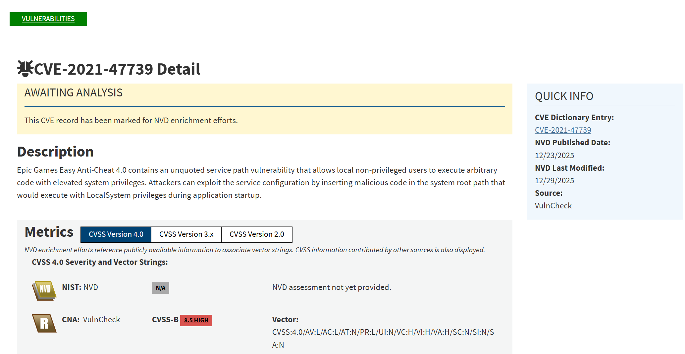

# Windows Service Enumeration | Windows Host Security Assessment

[](https://www.microsoft.com/windows)
[](https://learn.microsoft.com/powershell/)
[](https://nvd.nist.gov/)
[](https://learn.microsoft.com/windows-server/administration/windows-commands/netstat)

**Project by:** Alexander Cox  
**Project type:** Individual Windows enumeration and vulnerability-research lab  
**Original report:** `Enumeration Lab A.cox.docx` · Advanced Cyber Security · Caribbean Maritime University · February 20, 2026  
**Focus:** Service inventory • TCP listening ports • PID-to-process attribution • Software version review • CVE triage • Remediation

## Objective

Perform a controlled security review of a local Windows system by identifying running services, enumerating TCP listening ports, associating network activity with processes, reviewing installed software versions, and researching relevant known vulnerabilities. The final goal was to turn technical observations into a practical remediation plan.

This is **defensive enumeration and vulnerability research**, not exploitation. The Windows screenshots and reported versions are from a point-in-time lab exercise, not a current live scan.

## Skills Demonstrated

- Windows services inspection using the Services console and PowerShell.
- Filtering service status programmatically with `Get-Service` and `Where-Object`.
- TCP port enumeration and interpreting `LISTENING` entries using `netstat -ano`.
- Correlating network PIDs with executable names using `tasklist /FI`.
- Distinguishing core Windows components from third-party services.
- Identifying software versions and researching corresponding CVEs in the NVD.
- Prioritizing updates, least privilege, service reduction and network hardening.
- Separating **observed evidence**, **possible exposure**, and **unverified risk**.

## Tools and Evidence Sources

| Tool / source | Purpose |
| --- | --- |
| Windows Services console (`services.msc`) | Inspect service status, startup mode, and logon identity. |
| Windows PowerShell (`Get-Service`) | Collect a repeatable inventory of running services. |
| Windows `netstat -ano` | View local/remote endpoints, listening states and process IDs. |
| Windows `tasklist /FI` | Map selected PIDs to process executable names. |
| Control Panel → Programs and Features | Record installed software and visible version numbers. |
| [National Vulnerability Database](https://nvd.nist.gov/) | Research CVEs and published vulnerability descriptions. |
| [Microsoft Security Response Center](https://msrc.microsoft.com/update-guide/) | Check vendor-specific patch guidance for Microsoft products. |
| [Chrome Releases](https://chromereleases.googleblog.com/) | Confirm fixed Google Chrome versions. |

## Assessment Workflow

```text
Local Windows workstation
        |
        +-- 1. Enumerate services (Services GUI)
        |       |
        |       +-- Confirm running state and startup type
        |
        +-- 2. Filter running services (PowerShell)
        |       |
        |       +-- Build a service inventory
        |
        +-- 3. Enumerate listening ports (netstat)
        |       |
        |       +-- Record local address, port, state, PID
        |
        +-- 4. Attribute PIDs to processes (tasklist)
        |       |
        |       +-- Identify Windows and third-party executables
        |
        +-- 5. Review installed software versions
        |       |
        |       +-- Compare versions with vendor advisories
        |
        +-- 6. Research CVEs and assess evidence quality
                |
                +-- Prioritize practical remediation steps
```

> **Scope note:** `0.0.0.0` in a `LISTENING` socket means the process is bound to all local IPv4 interfaces. It does **not** by itself prove that the port is reachable from the internet; firewall rules, routing and external reachability require separate verification.

---

## Step 1 — Review Running Windows Services

I opened the Services management console to inspect services installed on the Windows workstation and see which ones were currently running.

```powershell
services.msc
```

This opens the Services MMC snap-in. The interface displays a service's **Name**, **Description**, **Status**, **Startup Type**, and **Log On As** information. These fields help distinguish necessary operating-system functions from optional third-party components.

Some of the services recorded in the report include:

| Service | Role / security relevance |
| --- | --- |
| AMD Crash Defender Service | Hardware/driver support; verify necessity before changing. |
| AMD External Events Utility | AMD graphics-related functionality. |
| Application Information | Windows elevation/UAC support. |
| AppX Deployment Service (`AppXSVC`) | Deployment of packaged Windows applications. |
| Armoury Crate Service | Third-party device management software. |
| ASUS App Service / ASUS Optimization | Vendor utilities; candidates for review if unused. |
| Bluetooth Support Service | Bluetooth features; assess business need. |
| Windows Audio | Audio subsystem; not an automatic security issue. |
| Base Filtering Engine (`BFE`) | Core Windows Filtering Platform component; should not be disabled casually. |



*Figure 1 — Windows Services console used to inspect running services, startup modes and logon accounts.*

**Analysis:** The presence of a running service is **not proof of a vulnerability**. Enumeration establishes a baseline for later investigation. Disabling essential services without validating dependencies can break system functionality or weaken security.

## Step 2 — Enumerate Running Services with PowerShell

To reproduce the GUI inventory in a queryable format, I used the PowerShell command shown in my report:

```powershell
Get-Service | Where-Object { $_.Status -eq 'Running' }
```

**How the command works:**

| Component | Explanation |
| --- | --- |
| `Get-Service` | Retrieves registered Windows services and their current states. |
| Pipe operator (`&#124;`) | Sends each service object to the next command. |
| `Where-Object` | Filters objects using a condition. |
| `$_` | Represents the service currently being evaluated. |
| `.Status -eq 'Running'` | Keeps only services whose status is `Running`. |

The resulting output shows the **service name**, **display name**, and **running status**. The image includes Windows components as well as AMD and ASUS services.



*Figure 2 — PowerShell inventory of running services.*

**Why it matters:** Scripting allows a SOC analyst or system administrator to repeat a baseline collection after patching or configuration changes and spot unexpected service additions.

## Step 3 — Identify TCP Listening Ports

The next step was to check which TCP endpoints were actively waiting for inbound connections:

```powershell
netstat -ano
```

**Command breakdown:**

| Option | Purpose |
| --- | --- |
| `-a` | Display all active connections and listening ports. |
| `-n` | Show numeric IP addresses and ports without name resolution. |
| `-o` | Include the owning process ID (PID). |

A `LISTENING` state indicates that a local process has opened a socket to accept connections. The port and PID provide a starting point for process attribution and firewall review.



*Figure 3 — `netstat -ano` output showing protocol, local/remote endpoints, state and PID.*

### Selected Listening Ports from the Report

| Protocol | Local address | Port | PID | Mapped executable | Interpretation |
| --- | --- | ---: | ---: | --- | --- |
| TCP | `0.0.0.0` | `135` | `2300` | `svchost.exe` | Windows RPC endpoint; consider scope and firewall exposure. |
| TCP | `0.0.0.0` | `445` | `4` | `System` | SMB-related Windows system socket; restrict unnecessary access. |
| TCP | `0.0.0.0` | `902` | `5952` | `vmware-authd.exe` | VMware service; assess need and permitted networks. |
| TCP | `0.0.0.0` | `5040` | `2548` | `svchost.exe` | Windows-hosted service; additional service mapping needed. |
| TCP | `0.0.0.0` | `12177` | `7108` | `ArmouryCrate.UserSessionHelper.exe` | ASUS utility; review need and vendor updates. |

The table reproduces the **five selected rows in the original report**. It is not a claim that only five ports were listening or that any of them were accessible from outside the host.

## Step 4 — Associate Process IDs with Executables

A port number alone does not identify the software responsible. I used `tasklist` filtering to connect the selected PIDs with executable names:

```cmd
tasklist /FI "PID eq 2300"
tasklist /FI "PID eq 4"
tasklist /FI "PID eq 5952"
tasklist /FI "PID eq 2548"
tasklist /FI "PID eq 7108"
```

The `/FI` switch applies a filter. `"PID eq 2300"`, for example, requests details for the process whose numeric ID is `2300`.



*Figure 4 — `tasklist /FI` mapping the selected listening ports to Windows and third-party processes.*

**What I concluded:** RPC/SMB-related processes and third-party management services were present. The next security step would be to verify whether each service is necessary and whether permitted inbound networks are restricted.

**Optional follow-up command — not shown as executed in the source report:**

```powershell
Get-CimInstance Win32_Service |
  Where-Object { $_.ProcessId -eq 2300 } |
  Select-Object Name, DisplayName, State, StartMode, PathName
```

This follow-up would map a shared `svchost.exe` PID to the underlying Windows services. It is included as a **recommended validation step**, not as a completed lab result.

## Step 5 — Inventory Installed Software Versions

I opened **Control Panel → Programs and Features** to identify installed application versions that could be checked against known vulnerabilities.



*Figure 5 — Installed-program inventory, including Chrome, .NET Runtime, and Epic Online Services.*

The screenshot shows:

| Product shown in screenshot | Version observed | Assessment relevance |
| --- | --- | --- |
| Microsoft .NET Runtime (x64) | `6.0.16.32323` (6.0.16) | Old runtime that requires patch and support-lifecycle review. |
| Google Chrome | `145.0.7632.118` | Version verification against the browser CVE researched in the report. |
| Epic Online Services | `4.1.0` | Installed Epic component; **not the same evidence as Easy Anti-Cheat 4.0**. |

**Evidence-quality finding:** The written report mentions Chrome `145.0.7632.45`, but the screenshot shows `145.0.7632.118`. Similarly, the report researched Easy Anti-Cheat 4.0, while the installed-program screenshot shows **Epic Online Services 4.1.0**. Those differences are important when deciding whether a CVE actually applies.

## Step 6 — Research and Triage Relevant CVEs

I used the National Vulnerability Database to investigate the potential impact of known flaws linked to software identified or discussed during enumeration.

A CVE entry is **research evidence**, not a vulnerability scan or proof of successful exploitation. Application version, affected component, enabled features, build number, vendor patches and the live host configuration must be checked before confirming exposure.

### 6.1 Microsoft .NET — CVE-2023-24897

**Research reference:** [NVD CVE-2023-24897](https://nvd.nist.gov/vuln/detail/CVE-2023-24897) · [Microsoft advisory](https://msrc.microsoft.com/update-guide/vulnerability/CVE-2023-24897)

The source report researched a remote-code-execution issue affecting certain .NET and Visual Studio releases. The screenshot inventory shows **.NET Runtime 6.0.16**, a release older than the `6.0.18` fix associated with this advisory.



*Figure 6 — NVD vulnerability entry used to research the installed .NET runtime.*

- **Evidence-supported concern:** An outdated runtime is installed and deserves validation and remediation.
- **Additional verification needed:** Identify applications depending on the runtime, confirm relevant component and patch applicability, and determine whether the runtime is actively in use.
- **Recommended fix:** Migrate dependent applications to a **currently supported .NET release**, test compatibility and remove unsupported runtimes when safe. Microsoft ended .NET 6 support on November 12, 2024; simply updating to an old 6.x patch is not an adequate long-term maintenance strategy.

### 6.2 Google Chrome — CVE-2026-2441

**Research reference:** [NVD CVE-2026-2441](https://nvd.nist.gov/vuln/detail/CVE-2026-2441) · [Google stable-channel release](https://chromereleases.googleblog.com/2026/02/stable-channel-update-for-desktop_13.html)

The report examined a **use-after-free vulnerability in Chrome's CSS component**, with the relevant fix released in the `145.0.7632.75/76` stable channel.



*Figure 7 — NVD record for Chrome CSS memory-safety vulnerability.*

- **Reported version:** `145.0.7632.45` is mentioned in the written report.
- **Actually shown in installed-software screenshot:** `145.0.7632.118`.
- **Assessment:** The screenshot version is **newer than the documented fixed release**. On this evidence, this CVE should **not** be reported as an active, confirmed vulnerability on the pictured installation.
- **Recommendation:** Maintain automatic browser updates and verify the installed version after updates.

### 6.3 Easy Anti-Cheat — CVE-2021-47739

**Research reference:** [NVD CVE-2021-47739](https://nvd.nist.gov/vuln/detail/CVE-2021-47739)

The report also researched an **unquoted service path** weakness associated with Easy Anti-Cheat 4.0. Unquoted executable paths containing spaces can, under specific conditions, create opportunities for local privilege escalation.



*Figure 8 — NVD research into an Easy Anti-Cheat unquoted-service-path issue.*

- **Evidence limitation:** The Programs and Features screenshot identifies **Epic Online Services 4.1.0**, not the exact Easy Anti-Cheat 4.0 service and its binary path.
- **Assessment:** **Not confirmed on the assessed host** from the supplied evidence.
- **Recommended verification:** Check whether the relevant Easy Anti-Cheat service exists and whether its actual `PathName` is unquoted and writable by an unprivileged user. Do not assume vulnerability from the publisher name alone.

## Findings and Evidence Confidence

| Finding / observation | Status | Explanation |
| --- | --- | --- |
| Running Windows and third-party services | **Observed** | Services console and PowerShell screenshots. |
| Selected local listening TCP sockets | **Observed** | `netstat -ano` and PID mapping screenshots. |
| .NET Runtime 6.0.16 installed | **Observed; remediation warranted** | Installed version is old and out of support; CVE applicability requires validation. |
| Chrome CVE-2026-2441 on the pictured installation | **Not demonstrated** | Installed screenshot version is newer than the published fix. |
| Easy Anti-Cheat CVE-2021-47739 on the pictured installation | **Not demonstrated** | Exact affected service/path is not shown. |
| Internet-accessible services / successful exploitation | **Not tested** | No external reachability test or exploit evidence in this lab. |

## Remediation Plan

| Priority | Recommendation | Rationale | Verification / success criterion |
| --- | --- | --- | --- |
| **High** | Assess and replace the outdated .NET 6 runtime with a supported release after compatibility testing. | Unsupported runtimes no longer receive standard security servicing. | Inventory runtime dependencies and confirm a supported runtime in `dotnet --list-runtimes`. |
| **High** | Review firewall access to TCP `135` and `445`, limiting inbound access to authorized networks where those services are required. | Reduces avoidable exposure of RPC/SMB-related ports. | Document Windows Firewall rules and test reachability from approved/unapproved subnets. |
| **Medium** | Keep Chrome and other third-party applications on vendor-supported, patched versions. | Addresses browser and third-party software risks. | Compare installed version to current vendor advisory and rerun inventory. |
| **Medium** | Audit optional vendor utilities and background services. | Reduces the attack surface when software is unnecessary. | Record owner, business justification, startup mode, and removal decision. |
| **Medium** | Review service account privileges and service executable paths. | Helps identify excessive privileges and unsafe service configurations. | Review logon identity, path quoting, and file-system ACLs for targeted services. |
| **Ongoing** | Maintain a baseline and repeat enumeration after updates. | Identifies new services and ports and validates changes. | Compare new `Get-Service`, `netstat`, and software inventory output with the baseline. |

### Suggested Validation Commands (not executed in the original screenshots)

```powershell
# List installed .NET runtimes
dotnet --list-runtimes

# Check the listening ports again
netstat -ano

# Display the Windows Firewall profiles
Get-NetFirewallProfile | Select-Object Name, Enabled, DefaultInboundAction

# Review the details of a specific service (example only)
Get-CimInstance Win32_Service -Filter "Name='BFE'" |
  Select-Object Name, StartMode, State, StartName, PathName
```

These are **follow-up recommendations** for a new validation run. The project does not claim that the lab implemented the fixes, proved remote access to the ports or performed exploitation.

## Key Lessons Learned

1. **Enumeration precedes vulnerability assessment.** Establish what is running before deciding what should be secured.
2. **Service, port and process inventories should be correlated.** PID attribution turns a generic open-port finding into a specific software investigation.
3. **A listening port is not necessarily externally exposed.** Firewall and network-path validation matter.
4. **CVE applicability must be checked, not inferred.** A researched vulnerability may not match the version actually installed.
5. **Effective security recommendations are actionable and verifiable.** Prioritize unsupported software, exposed administration services and unnecessary privileges, then validate the changes.

## Project Outcome

Completed a Windows host enumeration and vulnerability-research exercise using built-in Windows administration tools, documented five selected listening ports and their owning processes, reviewed installed software, researched three CVEs, and proposed a prioritized remediation plan. The exercise demonstrates **defensive host assessment, security troubleshooting, and risk-based reporting** relevant to SOC analysis, vulnerability management and IT risk assurance.

## References

- [Microsoft Learn — `Get-Service`](https://learn.microsoft.com/en-us/powershell/module/microsoft.powershell.management/get-service)
- [Microsoft Learn — `netstat`](https://learn.microsoft.com/en-us/windows-server/administration/windows-commands/netstat)
- [Microsoft Learn — `tasklist`](https://learn.microsoft.com/en-us/windows-server/administration/windows-commands/tasklist)
- [NVD — CVE-2023-24897](https://nvd.nist.gov/vuln/detail/CVE-2023-24897)
- [NVD — CVE-2026-2441](https://nvd.nist.gov/vuln/detail/CVE-2026-2441)
- [NVD — CVE-2021-47739](https://nvd.nist.gov/vuln/detail/CVE-2021-47739)
- [Google Chrome — February 2026 security release](https://chromereleases.googleblog.com/2026/02/stable-channel-update-for-desktop_13.html)
- [Microsoft .NET 6 end-of-support announcement](https://devblogs.microsoft.com/dotnet/dotnet-6-end-of-support/)

---

**Alexander Cox** · [GitHub](https://github.com/KerberosAC) · [LinkedIn](https://www.linkedin.com/in/alexandercox25/)
